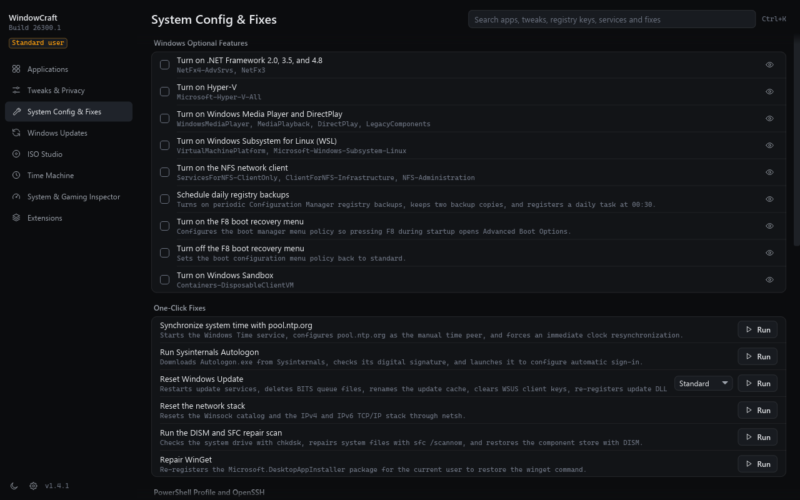

<!-- Made by Nordan -->
<p align="center">
  
</p>

<h1 align="center">WindowCraft</h1>

<p align="center">
  A native Windows 11 tool written in Rust (x64 and ARM64) for installing apps, removing bloat, applying privacy and performance tweaks, building custom installation media. Changes can be rolled back.
</p>

<p align="center">
  
  
  
  <a href="https://github.com/windowcraftdev/WindowCraft/releases/latest"></a>
</p>

<p align="center">
  <a href="https://windowcraft.dev"><b>windowcraft.dev</b></a> ·
  <a href="https://github.com/windowcraftdev/WindowCraft/releases/latest">Download</a> ·
  <a href="docs/RELEASE-NOTES-1.4.1.md">Release notes</a> ·
  <a href="#what-it-does">What it does</a> ·
  <a href="#install">Install</a> ·
  <a href="#privacy">Privacy</a> ·
  <a href="#build-and-test">Build and test</a> ·
  <a href="#support">Support</a> ·
  <a href="#license">License</a>
</p>

<p align="center">
  
  <br>
  <sub>Tweaks &amp; Privacy with the X-Ray Inspector open on Turn off Windows telemetry.</sub>
</p>

<table>
  <tr>
    <td width="25%" valign="top">
      <h3>Changes you can roll back</h3>
      Before every change WindowCraft saves the previous value. Time Machine keeps each run as a session, and a rollback undoes the whole session or one change. Removed packages, uninstalled apps and BitLocker decryption cannot be undone, and WindowCraft asks before them.
    </td>
    <td width="25%" valign="top">
      <h3>The X-Ray Inspector</h3>
      For any tweak it lists each registry value and service it touches, with the current value, the target and the value a rollback writes back. You see it before anything runs.
    </td>
    <td width="25%" valign="top">
      <h3>Nothing in the background</h3>
      A native program written in Rust, with no PowerShell scripts behind it. It runs no background service, tray icon, update check or telemetry, and connects only for an action you start.
    </td>
    <td width="25%" valign="top">
      <h3>ISO Studio</h3>
      Open a Windows 11 ISO or download one from a link on microsoft.com, write an answer file and export a new ISO or a USB drive. It can skip the hardware checks and the online account screens and inject drivers.
    </td>
  </tr>
</table>

## What it does

WindowCraft has nine pages in one window, plus `windowcraft-cli.exe` for automated runs. The full guide is on [windowcraft.dev](https://windowcraft.dev).

| Page | What it covers |
| :--- | :--- |
| Applications | 239 apps across 10 categories through WinGet or Chocolatey |
| Tweaks &amp; Privacy | 68 tweaks, 34 removable AppX packages and the presets Minimal (6), Standard (13) and Advanced (21) |
| System Config &amp; Fixes | 33 optional features and one-click repairs, Control Panel applets, a PowerShell profile and OpenSSH Server |
| Windows Updates | Default, Security (recommended) and Disabled update modes |
| ISO Studio | Answer files, driver injection, ISO export and USB writing |
| Time Machine | Every session with its changes, rollback of a session or of one change, drift detection |
| System &amp; Gaming Inspector | MSI interrupt mode, display timers, autoruns, a cache cleaner and a DNS benchmark over UDP, TCP and DoH |
| Extensions | Optional metadata stripper, file converter for 21 formats, ffmpeg and YouTube downloader, none installed by default |
| Settings | Eight interface languages, the theme, an optional scheduled drift check, support and website links |

<table>
  <tr>
    <td width="50%" valign="top">
      
      <br>
      <sub>Applications: 239 apps in 10 categories through WinGet or Chocolatey.</sub>
    </td>
    <td width="50%" valign="top">
      
      <br>
      <sub>System Config &amp; Fixes: optional Windows features and one-click repairs.</sub>
    </td>
  </tr>
  <tr>
    <td width="50%" valign="top">
      
      <br>
      <sub>Extensions: tools you install one at a time; everything runs on the computer.</sub>
    </td>
    <td width="50%" valign="top">
      
      <br>
      <sub>Settings: language, theme, the drift check and the support address.</sub>
    </td>
  </tr>
  <tr>
    <td colspan="2" align="center" valign="top">
      
      <br>
      <sub>First start: four questions pick a preset. Nothing changes until you run it.</sub>
    </td>
  </tr>
</table>

## Install

The current release is 1.4.1 on Windows 11 (build 22000 or later). Downloads are on the [Releases page](https://github.com/windowcraftdev/WindowCraft/releases/latest), and [docs/RELEASE-NOTES-1.4.1.md](docs/RELEASE-NOTES-1.4.1.md) lists what changed.

| File | Use it when |
| :--- | :--- |
| `WindowCraft-<version>-<arch>-setup.exe` | You want a normal installation with a Start menu entry. |
| `WindowCraft-<version>-<arch>.msi` | You deploy with Intune, GPO or `msiexec /qn`. |
| `WindowCraft-<version>-<arch>-portable.exe` | You want to run it without installing. |

Checksums are in `SHA256SUMS.txt`. The builds are not code-signed, so SmartScreen warns on the first run. Create a restore point before you apply changes; every preset starts with one.

An administrator can preset the interface language for every user with `WCLANGUAGE` (`en`, `pl`, `de`, `fr`, `es`, `it`, `pt-BR` or `uk`). A user's own choice in the app wins.

```powershell
msiexec /i WindowCraft-1.4.1-x64.msi WCLANGUAGE=pl /qn
```

## Privacy

This program will not transfer any information to other networked systems unless specifically requested by the user or the person installing or operating it. The actions that connect are the ones a user starts: WinGet or Chocolatey packages, Windows ISO and tool downloads, extensions, the YouTube downloader and the DNS benchmark. Those services have their own privacy policies.

## Build and test

You need the Rust toolchain from `rust-toolchain.toml`, the MSVC build tools and the Windows SDK.

```bash
cargo build --release -p windowcraft-app
cargo clippy --workspace --all-targets -- -D warnings
cargo test --workspace
```

`./packaging/build.ps1` builds the installers into `dist/`; add `-Architecture arm64` for ARM64. Tests never change live settings. Tests that change a real system run only in a VM, see [docs/VM-TEST-PLAN.md](docs/VM-TEST-PLAN.md). [CONTRIBUTING.md](CONTRIBUTING.md) has the rules for pull requests.

## Support

Write to <support@windowcraft.dev> or open an issue on [GitHub Issues](https://github.com/windowcraftdev/WindowCraft/issues). Security reports go through [SECURITY.md](SECURITY.md).

## License

WindowCraft is under the MIT License, see [LICENSE](LICENSE). [NOTICE.md](NOTICE.md) lists the third-party material in the repository and the installers, and [THIRD-PARTY-NOTICES.md](THIRD-PARTY-NOTICES.md) the licenses of the Rust crates and LAME.

Made by Nordan.
