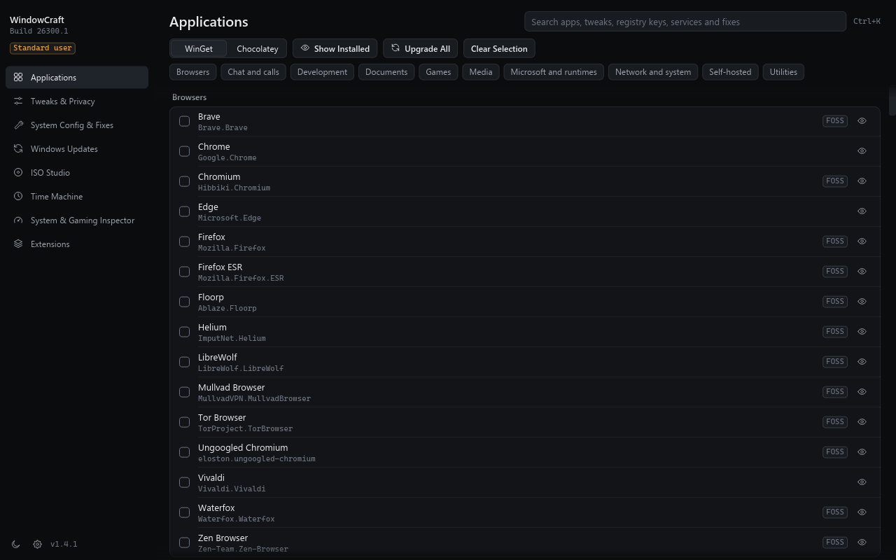
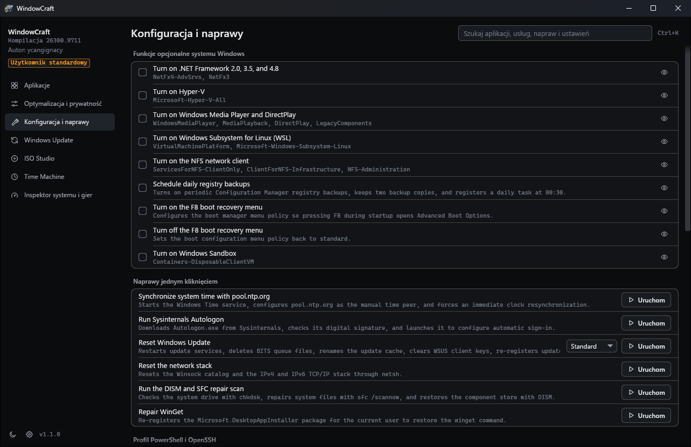

# WindowCraft

WindowCraft is a Windows 11 tool for installing apps, removing bloat, applying tweaks and building custom installation media. It is written in Rust and runs natively on x64 and ARM64. Before every change it records the previous value, so registry, service, task and Windows feature changes can be rolled back later.

The catalogs of applications, tweaks, features, AppX packages, DNS providers and presets come from Chris Titus Tech's WinUtil (<https://github.com/ChrisTitusTech/winutil>). WindowCraft is not affiliated with Chris Titus Tech or WinUtil.

## What it does

| Page | Contents |
| :--- | :--- |
| Applications | 239 packages, installed through WinGet or Chocolatey |
| Tweaks & Privacy | 68 tweaks and 34 removable AppX packages, with Minimal, Standard and Advanced presets |
| System Config & Fixes | 33 tools: optional Windows features, repairs, network and update resets, Control Panel applets |
| Windows Updates | Default, Security (recommended) and Disabled update policies |
| ISO Studio | Answer files, driver injection, app bundles, ISO output and USB writing |
| Time Machine | Every session with its changes, rollback of a session or of a single change, drift detection |
| System & Gaming Inspector | MSI interrupt mode, autoruns, cache cleaner, DNS benchmark over UDP, TCP and DoH |

The X-Ray Inspector shows, for any tweak, each registry value or service it touches with its current, target and undo value. Global search (Ctrl+K) covers apps, tweaks, registry keys, services, fixes and AppX packages.






## Languages

The interface is available in English, Polish, German, French, Spanish, Italian, Brazilian Portuguese and Ukrainian. On first start WindowCraft uses the Windows display language if it is one of these, and English otherwise. The language list at the bottom of the sidebar changes it at once, without a restart. The choice is saved per user in `%LOCALAPPDATA%\WindowCraft\settings.json`.

Names and descriptions of catalog entries (apps, tweaks, features) stay in English, and so do error details passed on from Windows and its tools, the job log and command line output.

`setup.exe` shows its pages in the Windows display language as well. An administrator can preset the language for every user with `WCLANGUAGE`:

```powershell
msiexec /i WindowCraft-1.0.0-x64.msi WCLANGUAGE=pl /qn
.\WindowCraft-1.0.0-x64-setup.exe WCLANGUAGE=de
```

The tags are `en`, `pl`, `de`, `fr`, `es`, `it`, `pt-BR` and `uk`. A user's own choice in the app wins over the preset.

## Download

Downloads are on the [Releases page](https://github.com/ycangignacy/WindowCraft/releases). Release notes for 1.0.0 are in [docs/RELEASE-NOTES-1.0.0.md](docs/RELEASE-NOTES-1.0.0.md).

| File | Use it when |
| :--- | :--- |
| `WindowCraft-<version>-<arch>-setup.exe` | You want a normal installation with a Start menu entry. |
| `WindowCraft-<version>-<arch>.msi` | You deploy with Intune, GPO or `msiexec /qn`. |
| `WindowCraft-<version>-<arch>-portable.exe` | You want to run it without installing. |

Checksums are in `SHA256SUMS.txt`. The builds are unsigned, so SmartScreen warns on first run. See the code signing policy below.

1.0.0 is a pre-release. The features that change the system have run in automated tests and on an elevated CI runner, but not yet on a real Windows install. Try it in a virtual machine or on a machine you can restore, and create a restore point first.

## Code signing policy

WindowCraft has applied for free code signing provided by [SignPath.io](https://about.signpath.io), with the certificate by [SignPath Foundation](https://signpath.org). Releases are unsigned until that is granted, and this section will say from which version on they are signed.

Signed files are built by the [release workflow](.github/workflows/release.yml) on GitHub-hosted runners from a tagged commit of this repository, and every signing request is approved by hand. Only files built from this repository are signed: `windowcraft.exe`, `windowcraft-cli.exe`, the MSI and `setup.exe`. The WiX Toolset parts inside the installers keep the state their maintainers publish them in.

| Role | Members |
| :--- | :--- |
| Committers and reviewers | [ycangignacy](https://github.com/ycangignacy) |
| Approvers | [ycangignacy](https://github.com/ycangignacy) |

### Privacy policy

This program will not transfer any information to other networked systems unless specifically requested by the user or the person installing or operating it.

The actions that do connect are the ones a user starts: installing or updating packages through [WinGet](https://learn.microsoft.com/en-us/windows/package-manager/) or [Chocolatey](https://chocolatey.org/privacy), downloading a Windows 11 ISO or a tool such as `OOSU10.exe`, the DNS benchmark, and the pinned downloads listed under Safety. Those services have their own privacy policies, for example [Microsoft's](https://privacy.microsoft.com/privacystatement) for WinGet and Windows downloads.

## Command line

```bash
windowcraft-cli --preset standard --run
windowcraft-cli --config "C:\path\to\config.json" --run
windowcraft-cli --check-drift --fix
windowcraft-cli --export-report "C:\report.json"
windowcraft-cli --open tweaks --inspect telemetry
```

The installers put `windowcraft-cli.exe` next to `windowcraft.exe`. A shell waits for it and gets its exit code, which `windowcraft.exe` cannot give because it is a GUI program. The portable build has only `windowcraft.exe`; in PowerShell use `Start-Process -Wait` or pipe it to `Out-Null`.

`--config` takes WindowCraft profiles and WinUtil JSON files. Without `--run`, a preset or config opens in the interface for review. Commands that change the system need an elevated terminal.

## Safety

Every change writes its previous value to the snapshot database before the first write. A tweak that fails reverts itself and the rest of the queue goes on. A rollback lists what it could not undo, and the session then shows "Partly rolled back".

A rollback turns off the Windows features WindowCraft turned on and leaves the ones that were already on. Parent features that DISM enabled along with them stay on. Rolling back `reg-backup` deletes its task, and rolling back OpenSSH Server removes its firewall rule. Removed packages, uninstalled apps and BitLocker decryption cannot be undone.

These services can never be disabled, whatever a config says: `RpcSs`, `DcomLaunch`, `LSM`, `BFE`, `mpssvc`, `WinDefend` and `ProfSvc`.

Third-party files that end up running on the machine are pinned. The CTT PowerShell profile and the Adobe hosts block list download from a fixed commit and must match a SHA-256 hash. Hosts lists keep sinkhole entries only. Downloaded executables must pass Authenticode before launch.

USB erasure requires the USB bus, no system volume, a sane disk layout and a matching model, checked again right before the first write. Generated answer files never configure disks, so Setup always asks where to install. The cache cleaner skips ISO Studio work files while an image is mounted or an ISO is open.

Temporary ACL changes live in a `Drop` guard, and the release profile keeps unwinding on so a panic cannot skip it. System files are replaced atomically, with a `.bak` copy.

## Footprint

WindowCraft runs no background service, tray icon, scheduled task, update check or telemetry. It opens a network connection only when you start an action that needs one, for example a package download. The only registry key of its own is `HKLM\SOFTWARE\WindowCraft`, and only when an installer was given `WCLANGUAGE`.

If you close the window during a job, WindowCraft asks first. Quit Anyway cancels the job, and the app exits once it stops.

Its data lives in `%LOCALAPPDATA%\WindowCraft`: Time Machine snapshots, the job log, settings, exports, downloaded tools and ISO Studio work files.

An uninstall removes that folder for every user, the `*.wcbak` folders left by Windows Update resets, the `AutoRegBackup` task and the registry key. Time Machine history goes with it, so roll changes back first if you want them undone. An upgrade keeps your data. For the portable build, run `windowcraft.exe --purge-data` from an elevated terminal, then delete the file. Without elevation it removes only your own data folder.

Settings you changed stay after uninstalling: tweaks, removed apps, installed packages including Chocolatey, OpenSSH Server with its firewall rule, restore points and the backups kept beside system files, for example `hosts.bak`.

## Build

You need the Rust toolchain from `rust-toolchain.toml`, the MSVC build tools and the Windows SDK.

```bash
cargo build --release -p windowcraft-app
```

The binary is `target/release/windowcraft.exe`, with the C runtime linked statically. It starts unelevated, and the sidebar badge restarts it as administrator.

To build the installers into `dist/`, run this from PowerShell. It downloads WiX 3.14 into `target/tools` and installs nothing on the machine.

```powershell
./packaging/build.ps1
```

For ARM64, run `./packaging/build.ps1 -Architecture arm64`. It needs `rustup target add aarch64-pc-windows-msvc`, the MSVC ARM64 tools and clang on PATH or in `target/tools/llvm`. `./packaging/make-icons.ps1` regenerates the icons and installer images from `crates/windowcraft-app/assets/logo-source.jpg`.

`./packaging/verify-install.ps1` installs and uninstalls both packages and checks that nothing stays behind. Run it from an elevated PowerShell on a machine you can afford to change. First runs of the system-changing features belong in a virtual machine, see [docs/VM-TEST-PLAN.md](docs/VM-TEST-PLAN.md).

## Verify

```bash
cargo check --workspace --all-targets
cargo clippy --workspace --all-targets -- -D warnings
cargo test --workspace
cargo test --workspace -- --ignored
```

The tests do not change live settings. Registry tests are confined to `HKCU\Software\WindowCraft_TestSandbox` and delete the key on drop, services run against an in-memory table, and native operations go to a recording runner. The `--ignored` tests need network access: they check the pinned downloads, TLS and the DNS benchmark. `crates/windowcraft-engine/tests/real_machine_probe.rs` reads the live system and writes nothing. When elevated, one DISM test reads feature states and changes nothing.

## Workspace

| Crate | Purpose |
| :--- | :--- |
| `windowcraft-physics` | Spring solver, velocity tracking, momentum, gestures, demand-driven timeline |
| `windowcraft-config` | Typed schemas, embedded catalogs, profiles, global search |
| `windowcraft-engine` | Win32, COM, WinRT and DISM adapters, snapshots, drift, inspection |
| `windowcraft-iso` | ISO Studio: WIM bindings, answer files, drivers, FAT32, USB guard |
| `windowcraft-app` | Graphical interface and translations |
| `windowcraft-cli` | Console program that waits and returns exit codes |

The interface renders in software through `tiny-skia`: 26 MB working set and 62 to 89 ms to a titled window. Its GDI surface keeps an alpha channel that DWM composites over Mica. `wgpu` is left out because it used about 120 MB more memory and added 54 crates.

See [NOTICE.md](NOTICE.md) for catalog and WiX attribution and [THIRD-PARTY-NOTICES.md](THIRD-PARTY-NOTICES.md) for Rust crate notices.

Made by ycangignacy.
