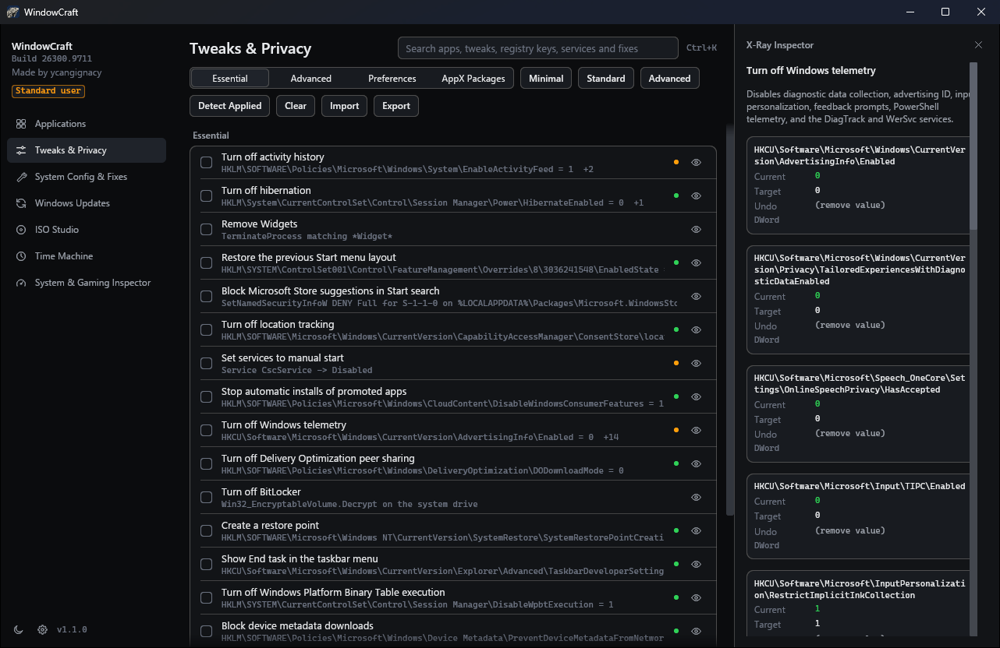
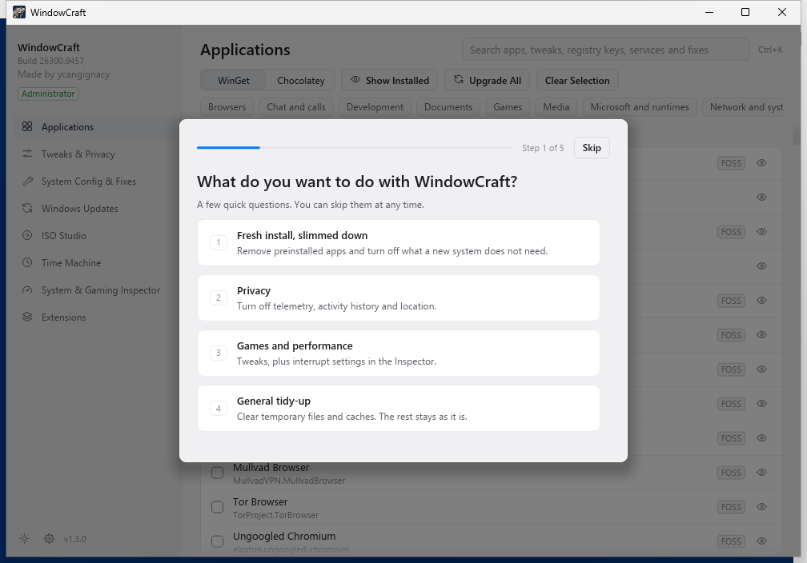
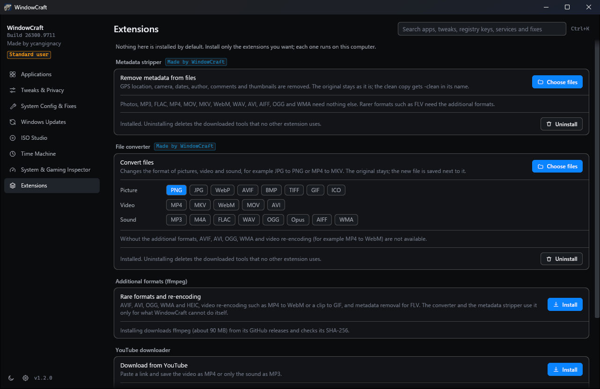

# WindowCraft

WindowCraft is a Windows 11 tool for installing apps, removing bloat, applying privacy and performance tweaks, and building custom installation media. It is a native program written in Rust for x64 and ARM64, with no PowerShell scripts behind it. Before every change it records the previous value, so changes can be rolled back later, one at a time or a whole session at once.

The current release is 1.3.0. Downloads are on the [Releases page](https://github.com/ycangignacy/WindowCraft/releases), and [docs/RELEASE-NOTES-1.3.0.md](docs/RELEASE-NOTES-1.3.0.md) says what changed and what was tested.



## What it does

| Page | Contents |
| :--- | :--- |
| Applications | 239 packages in 10 categories, installed, upgraded or removed through WinGet or Chocolatey |
| Tweaks & Privacy | 68 tweaks and 34 removable AppX packages, with Minimal (6), Standard (13) and Advanced (21) presets |
| System Config & Fixes | Optional Windows features, repairs, network and update resets, a PowerShell profile, OpenSSH Server, Control Panel applets |
| Windows Updates | Default, Security (recommended) and Disabled update policies |
| ISO Studio | Answer files, driver injection, app bundles, ISO output and USB writing |
| Time Machine | Every session with its changes, rollback of a session or of one change, drift detection |
| System & Gaming Inspector | MSI interrupt mode, autoruns, cache cleaner, DNS benchmark over UDP, TCP and DoH |
| Extensions | Optional tools, none installed by default: metadata stripper, file converter, extra formats through ffmpeg, YouTube downloader |
| Settings | Language, theme, an automatic check for reverted tweaks, the introduction and the tips again |

The X-Ray Inspector shows, for any tweak, each registry value or service it touches with its current, target and undo value. Ctrl+K searches apps, tweaks, registry keys, services, fixes and AppX packages.

Windows updates sometimes set a changed value back. WindowCraft shows a banner when that happened and puts the values back with one click. The automatic check in Settings, off by default, does the same on a schedule through a per-user task that only reads the system.

## First start

On the first start four short questions ask what you want to do, whether you keep your files, whether you build your own ISO and how much should change. Each answer has a number key. Start ticks the matching preset and opens the first page; nothing changes on the computer until you run it. Skip or Escape closes the questions on any screen, and they do not come back.

After that each page shows a short tip once. Next goes on to the next page, and Don't show again turns the tips off. Settings can bring back both.



## Install

| File | Use it when |
| :--- | :--- |
| `WindowCraft-<version>-<arch>-setup.exe` | You want a normal installation with a Start menu entry. |
| `WindowCraft-<version>-<arch>.msi` | You deploy with Intune, GPO or `msiexec /qn`. |
| `WindowCraft-<version>-<arch>-portable.exe` | You want to run it without installing. |

WindowCraft starts as a standard user. The badge at the top of the sidebar restarts it as administrator, which most changes need. Checksums are in `SHA256SUMS.txt`. The builds are not code-signed, so SmartScreen warns on the first run.

It draws on the GPU through Direct3D 12 and on the CPU through tiny-skia where no Direct3D 12 GPU exists, for example in a virtual machine. `ICED_BACKEND=tiny-skia` forces the CPU path.

Create a restore point before you apply changes. Every preset starts with one.

## Languages

The interface is in English, Polish, German, French, Spanish, Italian, Brazilian Portuguese and Ukrainian. It starts in the Windows display language when it is one of these, and Settings changes it at once. Catalog names and descriptions, error details from Windows, the job log and command line output stay in English.

An administrator can preset the language for every user. A user's own choice in the app wins.

```powershell
msiexec /i WindowCraft-1.3.0-x64.msi WCLANGUAGE=pl /qn
.\WindowCraft-1.3.0-x64-setup.exe WCLANGUAGE=de
```

The tags are `en`, `pl`, `de`, `fr`, `es`, `it`, `pt-BR` and `uk`.

## Extensions

| Extension | What it does | Downloads |
| :--- | :--- | :--- |
| Metadata stripper | Saves a copy of a photo, audio or video file without location, camera data, dates, author and similar metadata | Nothing |
| File converter | Converts pictures, video and sound between 21 formats, without re-encoding video where the target allows | Nothing |
| Additional formats | ffmpeg, for AVIF, AVI, OGG, WMA, HEIC and video re-encoding | About 90 MB |
| YouTube downloader | Saves one video as MP4 or its sound as MP3, without an account or cookies | About 150 MB |

Everything runs on the computer and no file is uploaded. Downloaded tools come from their GitHub releases and are checked against the SHA-256 the release publishes.



## Command line

```bash
windowcraft-cli --preset standard --run
windowcraft-cli --config "C:\path\to\config.json" --run
windowcraft-cli --check-drift --fix
windowcraft-cli --export-report "C:\report.json"
windowcraft-cli --open tweaks --inspect telemetry
```

The installers put `windowcraft-cli.exe` next to `windowcraft.exe`; it waits and returns an exit code. `--config` takes a profile exported from the Tweaks page, and without `--run` it opens the selection for review. Commands that change the system need an elevated terminal. `--export-report` leaves out the user name, computer name and paths.

## Safety

- Every change writes its previous value to the snapshot database before the first write. A tweak that fails reverts itself, and a rollback lists what it could not undo.
- Removed packages, uninstalled apps and BitLocker decryption cannot be undone. WindowCraft asks before an irreversible step.
- `RpcSs`, `DcomLaunch`, `LSM`, `BFE`, `mpssvc`, `WinDefend` and `ProfSvc` can never be disabled, whatever a profile says.
- Downloads that end up running are pinned to a SHA-256 hash or must pass Authenticode.
- USB writing checks the bus, the volumes and the disk model again right before the first write. Answer files never configure disks.

## Footprint and uninstall

WindowCraft runs no background service, tray icon, update check or telemetry. It connects to the network only for an action you start, such as a package download. Its data lives in `%LOCALAPPDATA%\WindowCraft`: Time Machine snapshots, the job log, settings, downloaded tools and ISO Studio work files.

Uninstalling from Installed apps removes that folder for every user, including the Time Machine history, so roll changes back first if you want them undone. An upgrade keeps the data. For the portable build, run `windowcraft.exe --purge-data` from an elevated terminal, then delete the file. Settings you changed in Windows stay after uninstalling.

## Privacy

This program will not transfer any information to other networked systems unless specifically requested by the user or the person installing or operating it. The actions that connect are the ones a user starts: WinGet or Chocolatey packages, Windows ISO and tool downloads, extensions, the YouTube downloader and the DNS benchmark. Those services have their own privacy policies.

## Build and test

You need the Rust toolchain from `rust-toolchain.toml`, the MSVC build tools and the Windows SDK.

```bash
cargo build --release -p windowcraft-app
cargo clippy --workspace --all-targets -- -D warnings
cargo test --workspace
```

`./packaging/build.ps1` builds the installers into `dist/`; add `-Architecture arm64` for ARM64. It downloads WiX 3.14 into `target/tools` and installs nothing. Tests never change live settings: registry tests use a sandbox key, services run against an in-memory table and native operations go to a recording runner. Tests that change a real system run only in a VM, see [docs/VM-TEST-PLAN.md](docs/VM-TEST-PLAN.md).

## License

WindowCraft is under the MIT License, see [LICENSE](LICENSE). [NOTICE.md](NOTICE.md) lists the third-party material in the repository and the installers, and [THIRD-PARTY-NOTICES.md](THIRD-PARTY-NOTICES.md) the licenses of the Rust crates.

Made by ycangignacy.
