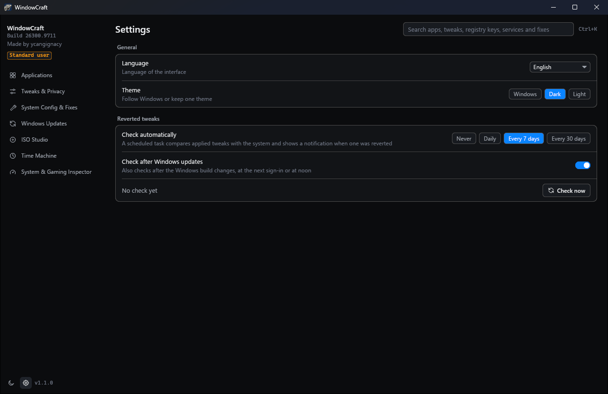
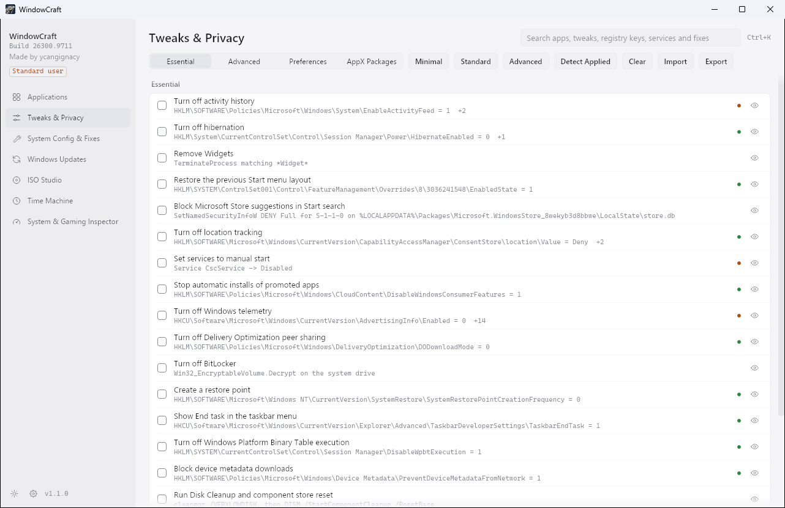

# WindowCraft

WindowCraft is a Windows 11 tool for installing apps, removing bloat, applying privacy and performance tweaks, and building custom installation media. It is a native program written in Rust for x64 and ARM64, with no PowerShell scripts behind it. Before every change it records the previous value, so registry, service, task and Windows feature changes can be rolled back later, one change or a whole session at a time.

The current release is 1.2.1. Downloads are on the [Releases page](https://github.com/ycangignacy/WindowCraft/releases), and [docs/RELEASE-NOTES-1.2.1.md](docs/RELEASE-NOTES-1.2.1.md) says what changed and what was tested.


## What it does

| Page | Contents |
| :--- | :--- |
| Applications | 239 packages in 10 categories, installed, upgraded or removed through WinGet or Chocolatey |
| Tweaks & Privacy | 68 tweaks and 34 removable AppX packages, with Minimal (6), Standard (13) and Advanced (21) presets |
| System Config & Fixes | 33 tools: optional Windows features, repairs, network and update resets, a PowerShell profile, OpenSSH Server, Control Panel applets |
| Windows Updates | Default, Security (recommended) and Disabled update policies |
| ISO Studio | Answer files, driver injection, app bundles, ISO output and USB writing |
| Time Machine | Every session with its changes, rollback of a session or of a single change, drift detection |
| System & Gaming Inspector | MSI interrupt mode, autoruns, cache cleaner, DNS benchmark over UDP, TCP and DoH |
| Extensions | Optional tools, none installed by default: a metadata stripper, a file converter, additional formats through ffmpeg and a YouTube downloader |
| Settings | Language, theme and a scheduled check for tweaks that Windows reverted |

The X-Ray Inspector shows, for any tweak, each registry value or service it touches with its current, target and undo value. A colored dot next to each tweak says whether it is applied. Global search (Ctrl+K) covers apps, tweaks, registry keys, services, fixes and AppX packages.

Windows updates and other programs sometimes set a value back after it was changed. WindowCraft notices this as configuration drift, shows a banner when it opens, and puts the values back with one click. Settings can also check on a schedule.







## Install

| File | Use it when |
| :--- | :--- |
| `WindowCraft-<version>-<arch>-setup.exe` | You want a normal installation with a Start menu entry. |
| `WindowCraft-<version>-<arch>.msi` | You deploy with Intune, GPO or `msiexec /qn`. |
| `WindowCraft-<version>-<arch>-portable.exe` | You want to run it without installing. |

`setup.exe` shows its pages in the Windows display language. Its first page has a checkbox, checked by default, that starts WindowCraft when setup finishes; the app then runs as you, without elevation. With `/quiet` or `/passive` it never starts the app, and `LaunchWindowCraft=0` on the command line clears the checkbox. The MSI on its own offers the same choice on its last page.

WindowCraft starts as a standard user. The badge at the top of the sidebar restarts it as administrator, which most changes need.

Checksums are in `SHA256SUMS.txt`. The builds are not code-signed yet, so SmartScreen warns on first run; see the code signing policy below.

Every feature that changes the system ran on Windows 11 Home 26H2 in VirtualBox before 1.0.1, and the 1.1.0 changes ran there again, including an apply and rollback of each of the 54 tweaks that can be undone. Create a restore point before you apply changes anyway. Every preset starts with one.

## Settings

The gear at the bottom of the sidebar opens Settings. The sun or moon icon next to it switches the theme in one click.

| Setting | What it does |
| :--- | :--- |
| Language | One of the eight interface languages. |
| Theme | Follow Windows, always dark or always light. The choice is kept between runs. |
| Check automatically | Never, daily, every 7 days or every 30 days. Off by default. |
| Check after Windows updates | Also checks when the Windows build number changes, which is what a cumulative update does. Off by default. |
| Check now | Compares the applied tweaks with the system at once. |

When one of the two check settings is on, WindowCraft registers a scheduled task named `WindowCraft drift check (<user name>)`. It runs as you, without elevation, three minutes after you sign in and once a day at noon, or as soon as the computer is on again after a missed noon. Each run reads `settings.json` and compares only when the chosen interval has passed or the build changed; otherwise it exits at once. It reads the system and changes nothing.

When something was reverted, a Windows notification says how many tweaks, and clicking it opens Time Machine, where Re-apply puts them back. If Windows notifications are turned off, a message box asks instead. While WindowCraft is open the task does nothing, because the window shows the same banner. Turning both settings off deletes the task, and so does uninstalling.

## Extensions

The Extensions page holds tools that are not about Windows itself. None of them is installed by default; each has its own Install button, and Uninstall removes it again.

| Extension | What it does | Downloads |
| :--- | :--- | :--- |
| Metadata stripper | Writes a copy of a photo, audio or video file without GPS location, camera data, dates, author, comments, cover art, chapters or encoder names. The copy gets `-clean` in its name. | Nothing |
| File converter | Converts pictures, video and sound between 21 formats, for example JPG to PNG, MP4 to MKV or FLAC to MP3. Video changes container without re-encoding where the target can hold the streams. | Nothing |
| Additional formats | ffmpeg, for what WindowCraft cannot do itself: AVIF, AVI, OGG, WMA and HEIC, video re-encoding such as MP4 to WebM, and metadata removal for FLV. | ffmpeg, about 90 MB |
| YouTube downloader | Saves one video as MP4 or its sound as MP3, without an account, cookies or history. The file goes through the metadata stripper afterwards. | yt-dlp, ffmpeg and Deno, about 150 MB |

Everything runs on the computer and no file is uploaded. The stripper and the converter are written in Rust as part of WindowCraft: pictures through the `image` crate, sound decoding through Symphonia, MP3 encoding through LAME, FLAC through flacenc, and MP4, MOV, MKV, WebM and Ogg through readers and writers of its own. Downloaded tools come from their own GitHub releases, are checked against the SHA-256 the release publishes and are kept in `%LOCALAPPDATA%\WindowCraft\tools`. No extension writes file names or links to the job log.


## Languages

The interface is available in English, Polish, German, French, Spanish, Italian, Brazilian Portuguese and Ukrainian. On first start WindowCraft uses the Windows display language if it is one of these, and English otherwise. The language list in Settings changes it at once, without a restart. The choice is saved per user in `%LOCALAPPDATA%\WindowCraft\settings.json`.

Names and descriptions of catalog entries stay in English, and so do error details passed on from Windows and its tools, the job log and command line output.

An administrator can preset the language for every user with `WCLANGUAGE`. A user's own choice in the app wins over the preset.

```powershell
msiexec /i WindowCraft-1.2.1-x64.msi WCLANGUAGE=pl /qn
.\WindowCraft-1.2.1-x64-setup.exe WCLANGUAGE=de
```

The tags are `en`, `pl`, `de`, `fr`, `es`, `it`, `pt-BR` and `uk`.

## Command line

```bash
windowcraft-cli --preset standard --run
windowcraft-cli --config "C:\path\to\config.json" --run
windowcraft-cli --check-drift --fix
windowcraft-cli --export-report "C:\report.json"
windowcraft-cli --open tweaks --inspect telemetry
windowcraft-cli --open settings
windowcraft-cli --open extensions
```

The installers put `windowcraft-cli.exe` next to `windowcraft.exe`. A shell waits for it and gets its exit code, which `windowcraft.exe` cannot give because it is a GUI program. The portable build has only `windowcraft.exe`; in PowerShell use `Start-Process -Wait` or pipe it to `Out-Null`.

`--config` takes a profile exported from the Tweaks page. Without `--run`, a preset or profile opens in the interface for review. Commands that change the system need an elevated terminal. `--export-report` writes a report of the system and the applied tweaks with no user name, computer name or path in it.

## Safety

Every change writes its previous value to the snapshot database before the first write. A tweak that fails reverts itself and the rest of the queue goes on. A rollback lists what it could not undo, and the session then shows "Partly rolled back".

A rollback turns off the Windows features WindowCraft turned on and leaves the ones that were already on. Parent features that DISM enabled along with them stay on. Rolling back `reg-backup` deletes its task, and rolling back OpenSSH Server removes its firewall rule. Removed packages, uninstalled apps and BitLocker decryption cannot be undone, and WindowCraft asks before an irreversible tweak.

These services can never be disabled, whatever a profile says: `RpcSs`, `DcomLaunch`, `LSM`, `BFE`, `mpssvc`, `WinDefend` and `ProfSvc`.

Third-party files that end up running on the machine are pinned. The Adobe hosts block list downloads from a fixed commit and must match a SHA-256 hash, and hosts lists keep sinkhole entries only. Downloaded executables must pass Authenticode before launch. The PowerShell profile on the System page is part of WindowCraft itself, so installing it downloads nothing. It keeps your own profile as a `.bak` copy, and removing it puts that copy back.

USB erasure requires the USB bus, no system volume, a sane disk layout and a matching model, checked again right before the first write. Generated answer files never configure disks, so Setup always asks where to install. The cache cleaner skips ISO Studio work files while an image is mounted or an ISO is open.

Temporary ACL changes live in a `Drop` guard, and the release profile keeps unwinding on so a panic cannot skip it. System files are replaced atomically, with a `.bak` copy.

## Footprint and uninstall

WindowCraft runs no background service, tray icon, update check or telemetry. It adds a scheduled task only when you turn on the automatic check in Settings. It opens a network connection only when you start an action that needs one, for example a package download. The only registry key of its own is `HKLM\SOFTWARE\WindowCraft`, and only when an installer was given `WCLANGUAGE`.

If you close the window during a job, WindowCraft asks first. Quit Anyway cancels the job, and the app exits once it stops.

Its data lives in `%LOCALAPPDATA%\WindowCraft`: Time Machine snapshots, the job log, settings, exports, downloaded tools and ISO Studio work files.

Uninstall from Installed apps in Windows Settings. Uninstall in the Start menu right-click menu opens the same page. The uninstaller closes WindowCraft if it is open, then removes that folder for every user, the `*.wcbak` folders left by Windows Update resets, the `AutoRegBackup` task, every user's drift check task and the registry key. Time Machine history goes with it, so roll changes back first if you want them undone. An upgrade keeps your data.

For the portable build, run `windowcraft.exe --purge-data` from an elevated terminal, then delete the file. Without elevation it removes only your own data folder and your own drift check task.

Settings you changed stay after uninstalling: tweaks, removed apps, installed packages including Chocolatey, OpenSSH Server with its firewall rule, restore points and the backups kept beside system files, for example `hosts.bak`.

## Build from source

You need the Rust toolchain from `rust-toolchain.toml`, the MSVC build tools and the Windows SDK.

```bash
cargo build --release -p windowcraft-app
```

The binary is `target/release/windowcraft.exe`, with the C runtime linked statically.

To build the installers into `dist/`, run this from PowerShell. It downloads WiX 3.14 into `target/tools` and installs nothing on the machine.

```powershell
./packaging/build.ps1
```

For ARM64, run `./packaging/build.ps1 -Architecture arm64`. It needs `rustup target add aarch64-pc-windows-msvc`, the MSVC ARM64 tools and clang on PATH or in `target/tools/llvm`. `./packaging/make-icons.ps1` regenerates the icons and installer images from `crates/windowcraft-app/assets/logo-source.jpg`.

## Tests

```bash
cargo check --workspace --all-targets
cargo clippy --workspace --all-targets -- -D warnings
cargo test --workspace
cargo test --workspace -- --ignored
```

The tests do not change live settings. Registry tests are confined to `HKCU\Software\WindowCraft_TestSandbox` and delete the key on drop, services run against an in-memory table, and native operations go to a recording runner. The `--ignored` tests need network access: they check the pinned downloads, TLS and the DNS benchmark. `crates/windowcraft-engine/tests/real_machine_probe.rs` reads the live system and writes nothing.

`./packaging/verify-install.ps1` installs and uninstalls both packages and checks that nothing stays behind. `crates/windowcraft-app/tests/live_vm.rs` holds the tests that change a real system; they run only in an elevated VirtualBox guest with `WINDOWCRAFT_LIVE_VM=1`. See [docs/VM-TEST-PLAN.md](docs/VM-TEST-PLAN.md).

## Workspace

| Crate | Purpose |
| :--- | :--- |
| `windowcraft-physics` | Spring solver, velocity tracking, momentum, gestures, demand-driven timeline |
| `windowcraft-config` | Typed schemas, embedded catalogs, profiles, global search |
| `windowcraft-engine` | Win32, COM, WinRT and DISM adapters, snapshots, drift, inspection, scheduled tasks |
| `windowcraft-iso` | ISO Studio: WIM bindings, answer files, drivers, FAT32, USB guard |
| `windowcraft-app` | Graphical interface, settings and translations |
| `windowcraft-cli` | Console program that waits and returns exit codes |

The interface draws on the GPU through `wgpu` with its Direct3D 12 backend only. On a computer without a Direct3D 12 GPU, such as a virtual machine without 3D acceleration, it draws on the CPU through `tiny-skia`. Set `ICED_BACKEND=tiny-skia` or `ICED_BACKEND=wgpu` to choose yourself.

The two paths cost different amounts. Measured on one PC with the Applications page open, the GPU path used a 113 MB working set and the CPU path 32 MB. On a 2560 by 1440 window a scrolled frame took about 36 ms on the CPU, which is too slow for eased scrolling, while the GPU path kept up with a 164 Hz display. Only the CPU path shows Mica behind the sidebar, because only its GDI surface keeps an alpha channel that DWM composites.

## Code signing policy

WindowCraft has applied for free code signing provided by [SignPath.io](https://about.signpath.io), with the certificate by [SignPath Foundation](https://signpath.org). Releases are unsigned until that is granted, and this section will say from which version on they are signed.

Signed files are built by the [release workflow](.github/workflows/release.yml) on GitHub-hosted runners from a tagged commit of this repository, and every signing request is approved by hand. Only files built from this repository are signed: `windowcraft.exe`, `windowcraft-cli.exe`, the MSI and `setup.exe`. The WiX Toolset parts inside the installers keep the state their maintainers publish them in.

| Role | Members |
| :--- | :--- |
| Committers and reviewers | [ycangignacy](https://github.com/ycangignacy) |
| Approvers | [ycangignacy](https://github.com/ycangignacy) |

### Privacy policy

This program will not transfer any information to other networked systems unless specifically requested by the user or the person installing or operating it.

The actions that do connect are the ones a user starts: installing or updating packages through [WinGet](https://learn.microsoft.com/en-us/windows/package-manager/) or [Chocolatey](https://chocolatey.org/privacy), downloading a Windows 11 ISO or a tool such as `OOSU10.exe`, installing an extension that downloads tools from GitHub, the YouTube downloader, the DNS benchmark, and the pinned downloads listed under Safety. The metadata stripper and the file converter work offline. Those services have their own privacy policies, for example [Microsoft's](https://privacy.microsoft.com/privacystatement) for WinGet and Windows downloads.

## License

WindowCraft is under the MIT License, see [LICENSE](LICENSE). [NOTICE.md](NOTICE.md) lists the third-party material in the repository and the installers, and [THIRD-PARTY-NOTICES.md](THIRD-PARTY-NOTICES.md) the licenses of the Rust crates.

Made by ycangignacy.
